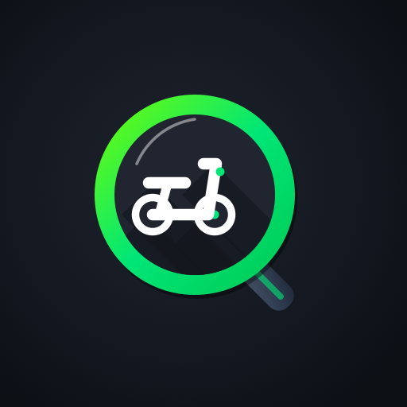

<p align="center">
  
</p>

# 🛵 Ola Diagnostic

A standalone Android mobile application built with **Kotlin & Jetpack Compose** to connect to MoveOS on the Ola S1 series (model and firmware support varies) over local Wi-Fi / Hotspot, stream raw vehicle CAN bus traffic (`vcan0`), display real-time automotive telemetry, and generate diagnostic summaries from the captured data.

---

## ⚡ Quick Start: How to Use

1. **Build the app:** Run `./gradlew :app:assembleDebug` for development testing. Debug builds are for development testing.
2. **Scooter Wi-Fi Setup:**
   - Turn on **Personal Hotspot** on your phone.
   - On the scooter touchscreen, go to **Settings > Wi-Fi** and connect to your phone's hotspot.
   - Wake the scooter using its normal dashboard controls while parked.
3. **Launch the App:**
   - Tap **Auto-Scan for Scooter** (or enter the IP e.g. `192.168.1.134` or MAC address).
   - Tap **Connect** — the app immediately connects to MoveOS diagnostics daemon (Port `50005`) and begins streaming live vehicle CAN frames!

---

## 📊 Categorized Tabs & Features

### 1. ⚡ Overview Dashboard
- **State of Charge (SOC):** Real-time battery SOC percentage and dashboard display SOC.
- **State of Health (SOH):** Estimated pack health percentage.
- **Pack Voltage & Current:** Live bus voltage (V) and current (A), with instant charging vs discharging state.
- **Instant Power (kW):** Real-time motor power draw or regenerative braking input.
- **Cell Delta Spread (mV):** Health difference between highest and lowest cell voltages.
- **Speed & Motor RPM:** Calculated live vehicle speed (km/h) and motor stator RPM.
- **Odometer:** Total lifetime distance traveled (km).

### 2. 🔋 14S Battery & Cell Balancer
- **14 Individual NMC Series Cell Voltages:**
  - Real-time voltages for channels 1 through 14 (derived from CAN IDs `0x1A5`, `0x1A6`, `0x1A9`, `0x1AA`).
  - Visual color-coded progress bars (3.0V to 4.2V range).
  - Dynamic **LOW** and **HIGH** cell badges to immediately identify cell drift and pack imbalance.
- **6 Pack Temperature Sensors:** Multi-probe temperature readings across the pack (`0x1A4`, `0x1A7`).

### 3. 🏍️ Motor & Thermals
- **Motor Stator & MCU Inverter Temperatures:**
  - Gauges with MoveOS thermal protection thresholds:
    - Normal (< 85°C)
    - Warning (95°C / 147°C)
    - Derate (105°C / 157°C throttle cut)
    - Emergency Cutoff (115°C / 165°C)
- **BMS AFE & PDU Temperatures:** Auxiliary electronic temperatures (`0x1A8`).

### 4. 🛡️ Safety & ECU Diagnostics
- **Vehicle Safety Flags (`0x683`):**
  - Side stand sensor state
  - Hill Hold Assist state
  - Regenerative braking dial level (Off, Low 5%, Med 10%, High 15%)
  - Fall / crash detection alert
  - Tow / tamper alert
- **Installed ECU Firmware Versions:**
  - VCU Firmware & Bootloader
  - BMS Firmware & Bootloader
  - MCU Firmware
  - Head Unit (HU) Firmware & Bootloader
  - BLE & MoveOS release versions

### 5. 📡 Raw CAN Stream & Optimized Logger
- **One-Tap "Record Logs" / "Stop & Save":**
  - Tap **Record Logs** to capture incoming CAN frames live from `vcan0`.
  - Displays a live recording banner: active blinking indicator, elapsed time (`MM:SS`), frame counter, and compressed storage size on disk.
- **Streaming GZIP Storage (~85% Space Saving):**
  - Rather than storing large uncompressed text files, frames are streamed directly through a memory-buffered **`GZIPOutputStream`** into `.csv.gz`.
  - Exports to the public **`Downloads/OlaCAN/`** folder (e.g. `OlaCAN_20261113_232140.csv.gz`).
  - Standard CSV format: `timestamp_ms,id_hex,dlc,data_hex` (compatible with SavvyCAN, Python Pandas, Excel, or VS Code).

---

## 🛠️ Architecture

```
Phone (Hotspot / Wi-Fi)
   │
   ├─> Auto-Discovery: IPv6 Multicast (ff02::1) / Neighbor Table / SLAAC EUI-64
   │
   └─> gRPC OkHttp Channel (Port 50005)
         │
         ├─> CanDumpStream: Server-streaming RPC pushing 16-byte raw CAN frames
         │     │
         │     └─> OlaCanDecoder: Intel little-endian bit-unpacking (DBC formulas)
         │           │
         │           └─> StateFlow: Reactive UI updates at 60 FPS (Jetpack Compose)
         │
         └─> ExecuteADBCommand: Unary queries for MoveOS ECU firmware versions
```

---

## Safety and compatibility

Release builds disable live vehicle-control commands. Development builds require fresh stationary speed telemetry for live commands. Demo mode simulates the dashboard without a vehicle connection.

The app uses the MoveOS diagnostic service over local Wi-Fi. The firmware check starts at MoveOS 4.0.5. Verify compatibility with your specific model and firmware. Vehicle use and maintenance decisions should follow the manufacturer's guidance.
