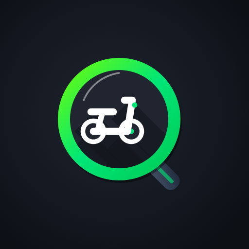
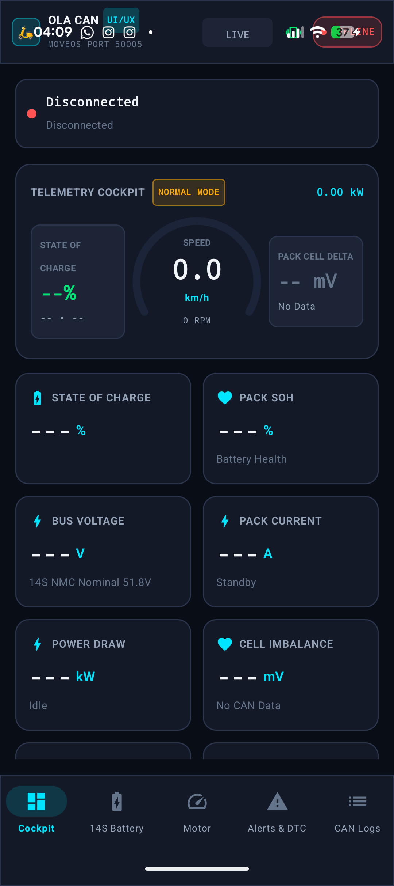
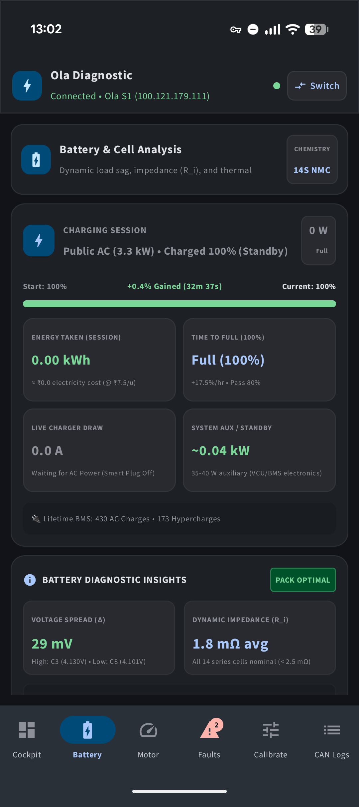
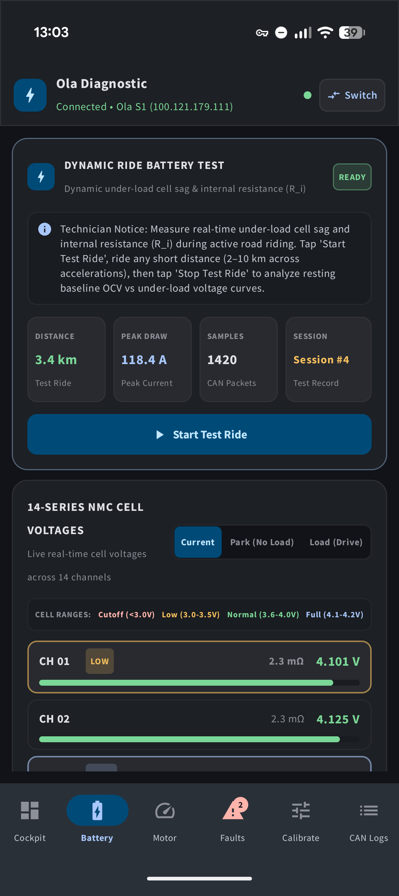
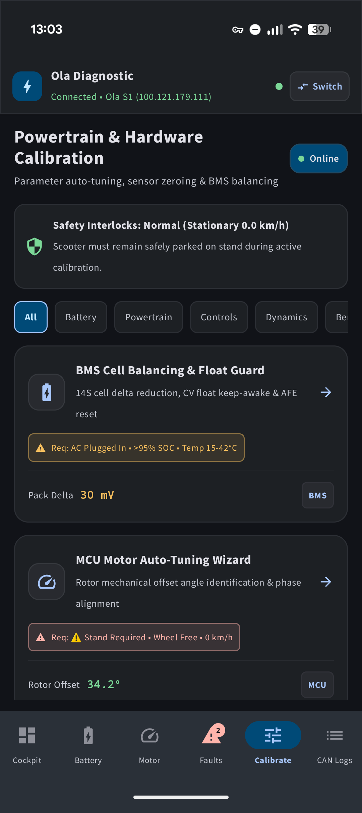
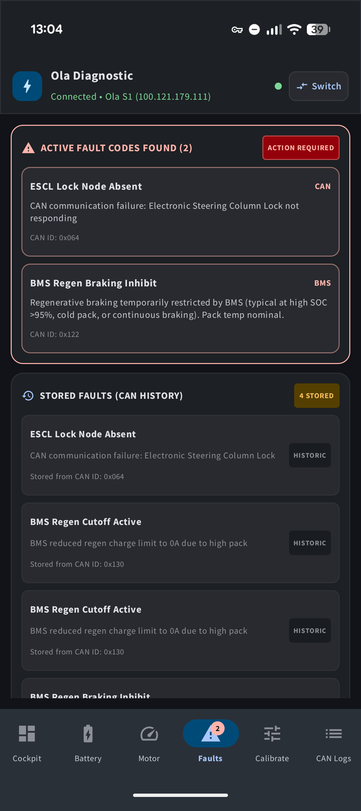

<p align="center">
  
</p>

<h1 align="center">Ola Diagnostic</h1>

<p align="center">
  <b>Advanced Automotive CAN Telemetry & Diagnostic Suite for Ola Electric S1 / S1 Pro / S1 Air</b><br>
  Built with Kotlin & Jetpack Compose • Direct MoveOS Diagnostics over Local Wi-Fi
</p>

<p align="center">
  
  
  
</p>

---

### 📲 Latest Release Download

👉 **[Download Ola Diagnostic v2.0.2 APK (Signed Release)](OlaDiagnostic-v2.0.2.apk)**

*Signed release for Android 8.0+ (ARM64 / x86_64). Simply download the `.apk` file directly on your Android phone and tap to install.*

---

## 📸 Application Screenshots

| ⚡ Live Telemetry Cockpit | 🔋 Battery Diagnosis & Health | 📊 Cell Voltage Balancer |
| :---: | :---: | :---: |
|  |  |  |

| 🔧 Powertrain & Hardware Calibration | ⚠️ Active DTC Fault Codes & Safety Alerts |
| :---: | :---: |
|  |  |

---

## ⚡ Core Capabilities & Features

### 1. ⚡ Live Telemetry Cockpit
- **Live Speed & Rotor RPM:** Precision vehicle velocity (km/h) and motor stator RPM.
- **Pack Voltage & Current:** High-voltage bus level (V) and continuous draw (A) across acceleration, cruising, and regen.
- **State of Charge (SOC) & Power (kW):** Instant battery percentage, active kilowatt draw, and lifetime odometer (km).
- **Cell Delta Spread:** Live millivolt difference between highest and lowest cells in real time.

### 2. 🔋 Battery Diagnosis & Health Engine
- **Individual Cell Voltages:** Real-time cell voltage monitoring across all channels with automated drift and balance tracking.
- **Rest vs Under-Load Sag Analysis:** Dynamic comparison between zero-load resting OCV and peak loaded acceleration (up to 118A+ WOT).
- **6 Pack Temperature Sensors:** Multi-probe thermal monitoring (Front, Left, Right, Rear, Core, and BMS AFE).
- **Coulomb Integrator SOH:** Coulomb-counting battery state-of-health estimation comparing actual Ah throughput against nominal 72 Ah factory capacity.

### 3. 🏍️ Motor & Powertrain Thermals
- **Motor Stator & MCU Inverter Temps:** Real-time heat tracking with MoveOS thermal protection thresholds:
  - *Normal (< 85°C)* • *Warning (95°C / 147°C)* • *Derate (105°C / 157°C)* • *Emergency Cutoff (115°C / 165°C)*
- **Throttle Sensor Calibration:** Live throttle potentiometer voltages (Reverse Regen 0.55V, Neutral 0.95V, WOT 3.85V).
- **Wheel Slip Ratio:** Real-time traction calculation comparing front wheel Hall sensor vs motor rotor resolver across 5.66 gear ratio.

### 4. 🔧 Live Vehicle Controls (Local Wi-Fi / Hotspot)
- **Instant Lock & Unlock:** Dispatches MoveOS MasterCommander frames (`0x6A1` & `0x6BC`) combined with power-management key events for instant physical locking and display sleep/wake.
- **Trunk / Boot Latch Release:** One-tap boot solenoid unlatch.
- **Display Wake & Panel Refresh:** Wake MoveOS touchscreen and refresh stuck HMI instances.
- **AFE Fault Register & Coulomb Unlatch:** Transmits `0x6DA` unlatch pulse to clear locked BMS AFE fault registers.
- **Dynamic Regen Level:** Configures deceleration regenerative braking drag levels (0% to 15%) via CAN `0x115`.

### 5. 🛡️ Safety & Automated Self-Test Suite
- **Guided Component Self-Tests:** Step-by-step diagnostic verification for Left/Right brake sensors, horn chime, indicators, exterior lighting, HV contactors, and e-SIM/GPS modules.
- **Safety Flags & DTC Catalog:** Live monitoring of kickstand interlock, fall/crash detection, hill hold, and diagnostic trouble codes.

### 6. 📡 High-Speed CAN Stream & Compressed Logger
- **Streaming SocketCAN:** Real-time frame parsing from `vcan0` via MoveOS gRPC channel on port `50005`.
- **Ultra-Compact GZIP Logging:** Memory-buffered `.csv.gz` streaming with **~85% space savings** (exports directly to phone `Downloads/OlaCAN/`).
- **PDF Report Generation:** One-tap export of diagnostic inspection certificates and battery health audits.

---

## 🚀 Quick Setup Guide

1. **Host Connection:** Turn on **Personal Hotspot** on your Android phone.
2. **Connect Scooter:** On the scooter touchscreen, navigate to **Settings > Wi-Fi** and connect to your phone's hotspot.
3. **Keep Scooter Awake:** Ensure the scooter **side stand is UP** (lowering the stand triggers MoveOS sleep mode).
4. **Launch Ola Diagnostic:** Open the app and tap **Auto-Scan for Scooter** (or enter the IP). Tap **Connect** to start streaming live telemetry!

---

## 🛠️ Repository Structure

```
├── OlaDiagnostic-v2.0.2.apk   # Compiled, signed release binary ready for installation
├── screenshots/               # High-resolution live vehicle UI captures
├── ola_diagnostic_icon.png    # Official app branding icon
├── OlaCanApp/                 # Complete Kotlin & Jetpack Compose Android Studio project
│   ├── app/
│   │   ├── src/main/java/com/sarthak/olacan/
│   │   │   ├── analyzer/      # SOH estimation & vehicle self-test suite
│   │   │   ├── decoder/       # CAN bit-unpacking DBC engine
│   │   │   ├── network/       # Multicast discovery & gRPC streaming client
│   │   │   ├── service/       # Background CAN streaming & vehicle controls
│   │   │   └── ui/            # Modern Material Design 3 screens & dialogs
│   │   └── build.gradle.kts
│   └── build.gradle.kts
└── README.md
```

---

## 🔨 Building from Source

To build from source using the Gradle wrapper (requires Android SDK 35 & JDK 17):

```bash
cd OlaCanApp
./gradlew :app:assembleRelease
```

---

## 👨‍💻 Author & Collaboration

This app was engineered from scratch in **2 days over a weekend**! Contributions, bug reports, and ideas are warmly welcomed — feel free to connect and collaborate.

<p align="left">
  <a href="https://www.linkedin.com/in/sarthaksaraswat/" target="_blank">
    
  </a>
  &nbsp;
  <a href="https://buymeacoffee.com/sarthaksaraswat" target="_blank">
    
  </a>
</p>

---

> [!CAUTION]
> **Warranty & Safety Disclaimer:**
> This project is an independent open-source tool and is **NOT affiliated with, endorsed by, or sponsored by Ola Electric Mobility Pvt Ltd**.
> Interacting with MoveOS diagnostic interfaces, unlatching safety registers, or sending custom frames on vehicle CAN buses carries inherent risks. Improper use **may void your scooter's manufacturer warranty**, affect MoveOS software support, or alter vehicle behavior. The software is provided "as is" strictly for diagnostic, research, and educational purposes.

---

## ⚖️ License

This project is open-source for educational, research, and non-commercial automotive diagnostic purposes. All trademarks, service marks, and company names are the property of their respective owners.
